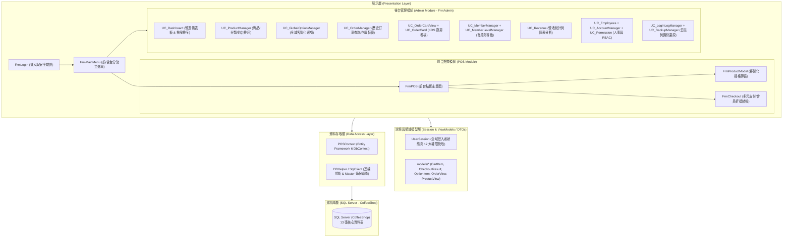
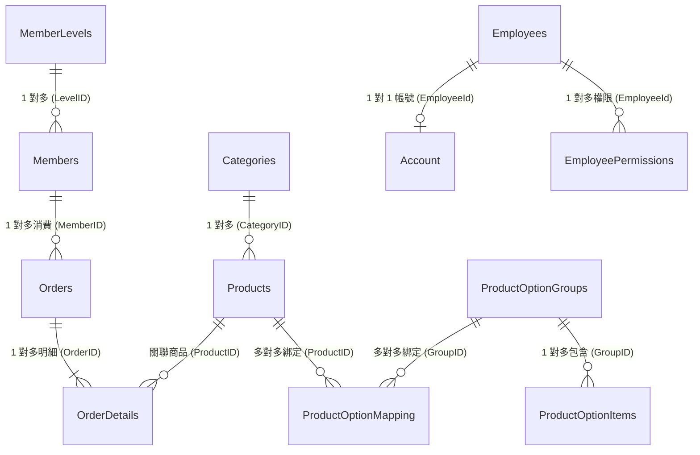

# SmartCoffeeSystem 專案架構與命名規範文件 (Architecture & Naming Conventions)

本文件詳述 **SmartCoffeeSystem（智慧咖啡廳 POS 與後台管理系統）** 的系統架構、模組職責劃分、資料庫設計，以及專案內部的命名規則與開發規範。

---

## 一、系統整體架構 (System Architecture)

本專案採用 **.NET Framework 4.8 (Windows Forms)** 開發，結合 **Entity Framework 6 (Database-First)** 與 **ADO.NET (`SqlClient`)** 進行資料存取。整體架構採 **三層式邏輯分離設計 (Three-Tier Logical Architecture)**，並以單一主容器搭配動態 `UserControl` 載入機制實作後台單頁式應用體驗 (SPA-like Navigation)。



---

## 二、目錄與檔案結構說明 (Directory Structure)

```text
SmartCoffeeSystem/
├── Database/                                # 附贈給面試官的資料庫檔案
│   ├── CoffeeShop_Init.sql                  # 一鍵建立資料庫結構與測試資料 SQL 腳本 (推薦優先使用)
│   └── CoffeeShop.bak                       # SQL Server 完整資料庫備份檔 (.bak)
├── SmartCoffeeSystem/                       # 主專案原始碼目錄
│   ├── View/                                # 後台各功能模組之 UserControl 視圖元件
│   │   ├── UC_Dashboard.cs                  # 後台首頁儀表板 (KPI 趨勢、4 大圖表、商品/訂單拖曳排序)
│   │   ├── UC_ProductManager.cs             # 商品管理、分類維護、前台排序調整、POS 預覽模式
│   │   ├── UC_GlobalOptionManager.cs        # 全域商品客製化選項群組與加價明細管理
│   │   ├── UC_OrderManager.cs               # 訂單綜合查詢、明細檢視、作廢與恢復
│   │   ├── UC_OrderCardView.cs              # KDS 後廚即時訂單看板 (每 5 秒智慧差異輪詢)
│   │   ├── UC_OrderCard.cs                  # KDS 單張訂單卡片元件 (逾時 15 分鐘紅字警示、一鍵完單)
│   │   ├── UC_MemberManager.cs              # 會員資料 CRUD、軟刪除與預設載具/統編綁定
│   │   ├── UC_MemberLevelManager.cs         # 會員等級、結帳折扣率與點數倍率設定
│   │   ├── UC_Revenue.cs                    # 區間營收 KPI、每日營收趨勢、會員佔比與熱銷排行
│   │   ├── UC_Employees.cs                  # 員工資料管理 (離職/停用自動聯動鎖定登入帳號)
│   │   ├── UC_AccountManager.cs             # 系統帳號管理、失敗次數檢視、手動解鎖/停用
│   │   ├── UC_Permission.cs                 # 依職稱角色批次配置 12 大系統權限 (RBAC)
│   │   ├── UC_LoginLogManager.cs            # 登入紀錄複合條件查詢與分頁檢視
│   │   └── UC_BackupManager.cs              # SQL Server 資料庫完整備份 (.bak) 與強制單人模式還原
│   ├── models/                              # 視圖模型 (ViewModels)、資料傳輸物件 (DTO) 與狀態管理
│   │   ├── UserSession.cs                   # 靜態類別：保存當前登入員工資訊與權限清單
│   │   ├── CartItem.cs                      # 前台購物車單一項目模型 (含客製化規格與小計計算)
│   │   ├── CheckoutResult.cs                # 結帳彈窗回傳給 POS 主畫面的結帳結果封裝物件
│   │   ├── OptionItem.cs                    # 客製化選項項目顯示與加價封裝模型
│   │   ├── OrderView.cs                     # 綁定後台 DataGridView 使用之訂單檢視模型
│   │   └── ProductView.cs                   # 綁定後台 DataGridView 使用之商品檢視模型
│   ├── Services/                            # 密碼雜湊與輔助服務
│   │   ├── Services.cs                      # BCrypt 密碼雜湊封裝方法
│   │   └── AccountRepository.cs             # ADO.NET 帳號資料存取封裝類別
│   ├── ProductImages/                       # 商品圖片資源目錄 (自動複製至輸出目錄)
│   ├── Properties/                          # 組件資訊 (AssemblyInfo)、內嵌圖片資源 (Resources)
│   ├── FrmLogin.cs                          # 系統登入視窗 (圖形驗證碼、IP 防暴力破解、BCrypt 驗證)
│   ├── FrmMainMenu.cs                       # 主選單視窗 (依權限動態顯示前台 POS / 後台管理入口)
│   ├── FrmPOS.cs                            # 前台 POS 收銀點餐系統 (支援正式點餐與後台預覽模式)
│   ├── FrmProductModal.cs                   # 點餐商品客製化規格、加價與備註選擇對話框
│   ├── FrmCheckout.cs                       # 結帳對話框 (會員手機查詢、等級折扣、點數折抵、載具/支付)
│   ├── FrmAdmin.cs                          # 後台管理主框架 (側邊摺疊選單、動態麵包屑導航、權限攔截)
│   ├── ProductEditForm.cs                   # 商品新增與修改對話框 (含圖片安全流式預覽與上傳)
│   ├── FrmCategoryEdit.cs                   # 商品分類新增與修改對話框 (含 FontAwesome 圖示選擇器)
│   ├── FrmProductOptionManager.cs           # 單一商品綁定客製化選項群組對話框
│   ├── FrmSelectGroup.cs                    # 選擇既有選項群組或建立新群組對話框
│   ├── FrmAccountEdit.cs                    # 員工系統帳號新增/修改對話框 (含密碼強度即時檢測)
│   ├── FrmInput.cs                          # 通用單行文字輸入對話框
│   ├── HighQualityPictureBox.cs             # 自訂高畫質抗鋸齒 PictureBox 控制項
│   ├── DBHelper.cs                          # SQL Server 連線狀態診斷工具類別
│   ├── POSModel.edmx                        # Entity Framework 6 實體資料模型 (含 Context 與 13 個實體)
│   ├── Program.cs                           # 應用程式進入點與 SunnyUI 繁體中文化全域設定
│   └── App.config                           # 資料庫連線字串 (POSContext 與 POS_Sql) 設定檔
├── SmartCoffeeSystem.sln                    # Visual Studio 解決方案檔 (相容 VS 2019 / 2022 / 2026)
└── SmartCoffeeSystem.slnx                   # Visual Studio XML 解決方案檔
```

---

## 三、命名規則與編碼規範 (Naming Conventions & Coding Standards)

本專案遵循 C# / Windows Forms 團隊開發命名慣例，具體規則如下：

### 1. 命名空間 (Namespaces)

| 命名空間 | 用途說明 |
| :--- | :--- |
| `SmartCoffeeSystem` | 專案根命名空間，包含主表單 (`Frm*`)、EF6 `POSContext`、資料表實體類別、全域 `UserSession` 與 `DBHelper` |
| `SmartCoffeeSystem.View` | 存放後台管理系統的各模組 `UserControl` (`UC_*`) |
| `SmartCoffeeSystem.models` | 存放非資料庫直接映射之 ViewModel、DTO 與輔助模型 (`CartItem`, `CheckoutResult`, `ProductView`, `OrderView`, `OptionItem`) |
| `SmartCoffeeSystem.Services` | 存放商業邏輯輔助服務與密碼雜湊工具 |
| `SmartCoffeeSystem.Properties` | 系統自動產生的強型別資源 (`Resources`) 與設定 (`Settings`) |

---

### 2. 檔案與類別命名規則 (Files & Classes)

| 類型 | 命名規則 (Prefix / Suffix) | 範例 | 說明 |
| :--- | :--- | :--- | :--- |
| **表單視窗 (Form)** | `Frm` + `PascalCase` (或 `*Form`) | [`FrmLogin`](file:///C:/Users/crazs/Desktop/%E5%B0%88%E9%A1%8C/%E5%80%8B%E4%BA%BA%E5%B0%88%E9%A1%8C/SmartCoffeeSystem/FrmLogin.cs), [`FrmPOS`](file:///C:/Users/crazs/Desktop/%E5%B0%88%E9%A1%8C/%E5%80%8B%E4%BA%BA%E5%B0%88%E9%A1%8C/SmartCoffeeSystem/FrmPOS.cs), [`FrmAdmin`](file:///C:/Users/crazs/Desktop/%E5%B0%88%E9%A1%8C/%E5%80%8B%E4%BA%BA%E5%B0%88%E9%A1%8C/SmartCoffeeSystem/FrmAdmin.cs), [`FrmCheckout`](file:///C:/Users/crazs/Desktop/%E5%B0%88%E9%A1%8C/%E5%80%8B%E4%BA%BA%E5%B0%88%E9%A1%8C/SmartCoffeeSystem/FrmCheckout.cs), [`ProductEditForm`](file:///C:/Users/crazs/Desktop/%E5%B0%88%E9%A1%8C/%E5%80%8B%E4%BA%BA%E5%B0%88%E9%A1%8C/SmartCoffeeSystem/ProductEditForm.cs) | 獨立彈出視窗、對話框或主畫面 |
| **使用者控制項 (UserControl)** | `UC_` + `PascalCase` | [`UC_Dashboard`](file:///C:/Users/crazs/Desktop/%E5%B0%88%E9%A1%8C/%E5%80%8B%E4%BA%BA%E5%B0%88%E9%A1%8C/SmartCoffeeSystem/View/UC_Dashboard.cs), [`UC_ProductManager`](file:///C:/Users/crazs/Desktop/%E5%B0%88%E9%A1%8C/%E5%80%8B%E4%BA%BA%E5%B0%88%E9%A1%8C/SmartCoffeeSystem/View/UC_ProductManager.cs), [`UC_OrderCardView`](file:///C:/Users/crazs/Desktop/%E5%B0%88%E9%A1%8C/%E5%80%8B%E4%BA%BA%E5%B0%88%E9%A1%8C/SmartCoffeeSystem/View/UC_OrderCardView.cs) | 嵌入於 `FrmAdmin` 主面板 (`panelDesktop`) 的子頁面或可重用卡片 (`UC_OrderCard`) |
| **EF 資料庫實體 (Entity)** | 單數名詞 `PascalCase` | [`Product`](file:///C:/Users/crazs/Desktop/%E5%B0%88%E9%A1%8C/%E5%80%8B%E4%BA%BA%E5%B0%88%E9%A1%8C/SmartCoffeeSystem/Product.cs), [`Category`](file:///C:/Users/crazs/Desktop/%E5%B0%88%E9%A1%8C/%E5%80%8B%E4%BA%BA%E5%B0%88%E9%A1%8C/SmartCoffeeSystem/Category.cs), [`Order`](file:///C:/Users/crazs/Desktop/%E5%B0%88%E9%A1%8C/%E5%80%8B%E4%BA%BA%E5%B0%88%E9%A1%8C/SmartCoffeeSystem/Order.cs), [`OrderDetail`](file:///C:/Users/crazs/Desktop/%E5%B0%88%E9%A1%8C/%E5%80%8B%E4%BA%BA%E5%B0%88%E9%A1%8C/SmartCoffeeSystem/OrderDetail.cs), [`Member`](file:///C:/Users/crazs/Desktop/%E5%B0%88%E9%A1%8C/%E5%80%8B%E4%BA%BA%E5%B0%88%E9%A1%8C/SmartCoffeeSystem/Member.cs) | 由 `POSModel.tt` 從資料庫自動產生，對應 `POSContext` 中的複數 `DbSet<T>` |
| **檢視模型 (ViewModel / DTO)** | 名詞 + `View` / `Item` / `Result` | [`ProductView`](file:///C:/Users/crazs/Desktop/%E5%B0%88%E9%A1%8C/%E5%80%8B%E4%BA%BA%E5%B0%88%E9%A1%8C/SmartCoffeeSystem/models/ProductView.cs), [`OrderView`](file:///C:/Users/crazs/Desktop/%E5%B0%88%E9%A1%8C/%E5%80%8B%E4%BA%BA%E5%B0%88%E9%A1%8C/SmartCoffeeSystem/models/OrderView.cs), [`CartItem`](file:///C:/Users/crazs/Desktop/%E5%B0%88%E9%A1%8C/%E5%80%8B%E4%BA%BA%E5%B0%88%E9%A1%8C/SmartCoffeeSystem/models/CartItem.cs), [`CheckoutResult`](file:///C:/Users/crazs/Desktop/%E5%B0%88%E9%A1%8C/%E5%80%8B%E4%BA%BA%E5%B0%88%E9%A1%8C/SmartCoffeeSystem/models/CheckoutResult.cs) | 專供 `DataGridView` 資料綁定或跨表單傳遞資料使用，避免直接暴露資料庫實體 |
| **靜態工具與狀態類別** | `PascalCase` | [`UserSession`](file:///C:/Users/crazs/Desktop/%E5%B0%88%E9%A1%8C/%E5%80%8B%E4%BA%BA%E5%B0%88%E9%A1%8C/SmartCoffeeSystem/models/UserSession.cs), [`DBHelper`](file:///C:/Users/crazs/Desktop/%E5%B0%88%E9%A1%8C/%E5%80%8B%E4%BA%BA%E5%B0%88%E9%A1%8C/SmartCoffeeSystem/DBHelper.cs) | 全域共享的登入資訊與資料庫連線測試工具 |

---

### 3. UI 控制項命名規則 (UI Control Prefixes)

專案內的 Windows Forms、SunnyUI 與 FontAwesome.Sharp 控制項統一採用 **縮寫前綴 + 功能描述 (`camelCase`)** 命名：

| 控制項類別 | 標準前綴 (Prefix) | 專案內實際命名範例 |
| :--- | :--- | :--- |
| `Button` / `UIButton` | `btn` | `btnLogin`, `btnCheckout`, `btnClear`, `btnSave`, `btnCancel`, `btnFirstPage` |
| `IconButton` (FontAwesome) | `ibtn` | `ibtnProduct`, `ibtnOrder`, `ibtnMember`, `ibtnRevenue`, `ibtnAuth`, `ibtnSystem` |
| `TextBox` / `UITextBox` | `txt` | `txtUsername`, `txtPassword`, `txtSearch`, `txtPhone`, `txtUsePoints` |
| `Label` / `UILabel` | `lbl` | `lblClock`, `lblWelcome`, `lblTotalCount`, `lblGrandTotal`, `lblPageInfo` |
| `ComboBox` / `UIComboBox` | `cbo` / `cmb` / `cb` | `cboFilterCategory`, `cboStatus`, `cmbCategory`, `cmbEmployee`, `cbTitle` |
| `DataGridView` / `UIDataGridView` | `dgv` | `dgvProducts`, `dgvCategories`, `dgvOrders`, `dgvDetails`, `dgvMembers`, `dgvLogs` |
| `DataGridViewColumn` | `col` | `colProdID`, `colProdName`, `colPrice`, `colOrderID`, `colStatus` |
| `Panel` / `UIPanel` | `pnl` / `panel` | `panelDesktop`, `panelSidebar`, `panelLeft`, `panelCenter`, `panelCart`, `pnlUserLine` |
| `FlowLayoutPanel` | `flp` / `flow` | `flpDetails`, `flowOptions`, `flowLayoutPanelBreadcrumb`, `flowLayoutPanelCards` |
| `PictureBox` | `pic` | `picLogo`, `picCaptcha`, `picProduct`, `picEdit` |
| `DateTimePicker` / `UIDatePicker` | `dp` / `dtp` | `dpStart`, `dpEnd`, `dtpStart`, `dtpEnd` |
| `CheckBox` / `CheckedListBox` | `chk` | `chkActive`, `chkPermissions` |
| `ListBox` / `UIListBox` | `lst` / `list` | `lstRoles`, `listSortProducts` |
| `Chart` (MSChart) | `chart` | `chartRevenue`, `chartCategory`, `chartHotProduct`, `chartOrderStatus`, `chartMember` |
| `Timer` | `timer` / `_...Timer` | `timerClock`, `_autoRefreshTimer` |

---

### 4. 變數、屬性與方法命名規則 (Variables, Properties & Methods)

1. **私有欄位 (Private Fields)**：
   - 狀態旗標與跨方法追蹤之關鍵欄位以底線 `_camelCase` 命名：
     - `_isLoaded`：防止 `ComboBox` 或 `TextBox` 在 `InitializeComponent()` 初始化階段誤觸發 `SelectedIndexChanged` / `TextChanged` 查詢的防呆旗標。
     - `_isPreviewMode`：`FrmPOS` 區分「正式點餐」與「後台預覽模式」的狀態欄位。
     - `_currentGroupId` / `_currentMemberId` / `_currentLevelId` / `_currentEditingId`：記錄當前在右側編輯面板選中或正在編輯的主鍵 ID（`0` 代表新增模式，`> 0` 代表修改模式）。
     - `_editEmpId` (`int?`)：以 `null` 代表新增模式、`HasValue` 代表修改模式。
   - 畫面配色常數與快取集合使用 `camelCase`（如 `primaryColor`, `shoppingCart`, `allProductViews`）。
2. **公開屬性 (Public Properties)**：
   - 律採用 `PascalCase`（如 `IsPreviewMode`, `SelectedSpecString`, `FinalQuantity`, `FinalUnitPrice`, `ProductEntity`）。
3. **方法命名 (Methods)**：
   - 動詞開頭之 `PascalCase`：
     - 資料載入：`LoadProducts()`, `LoadCategories()`, `LoadPendingOrders()`, `LoadRevenueData()`, `QueryLogs()`
     - 畫面初始化與更新：`SetupCustomDynamicUI()`, `UpdateCartUI()`, `UpdateTotalDisplay()`, `ApplyPermissionUIVisibility()`
     - 排序交換：`SwapCategorySort()`, `SwapGroupSort()`, `SwapItemSort()`
4. **事件處理常式 (Event Handlers)**：
   - 採用 `控制項名稱_事件名稱` 格式（如 `btnCheckout_Click`, `dgvGroups_SelectionChanged`, `txtSearch_TextChanged`）。

---

### 5. RBAC 權限代碼命名規則 (Permission Key Conventions)

系統於 [`UC_Permission.cs`](file:///C:/Users/crazs/Desktop/%E5%B0%88%E9%A1%8C/%E5%80%8B%E4%BA%BA%E5%B0%88%E9%A1%8C/SmartCoffeeSystem/View/UC_Permission.cs) 與 [`EmployeePermission`](file:///C:/Users/crazs/Desktop/%E5%B0%88%E9%A1%8C/%E5%80%8B%E4%BA%BA%E5%B0%88%E9%A1%8C/SmartCoffeeSystem/EmployeePermission.cs) 資料表中定義了 **12 大權限 Key**，統一採用 `模組名稱_操作權限` (`<Module>_<Scope>`) 命名法：

| 編號 | 權限代碼 (`PermissionKey`) | 對應功能模組 | 權限性質 |
| :---: | :--- | :--- | :--- |
| 1 | `POS_System` | 前台 POS 點餐系統 & 後台訂單列表查詢 | 系統操作 / 查詢 |
| 2 | `Product_CRUD` | 商品管理、分類維護、前台排序設定 | 完整增刪改查 |
| 3 | `ProductOption_CRUD` | 全域商品客製化選項設定 (`UC_GlobalOptionManager`) | 完整增刪改查 |
| 4 | `Member_CRUD` | 會員列表管理 (`UC_MemberManager`) | 完整增刪改查 |
| 5 | `MemberLevel_CRUD` | 會員等級與折扣/點數倍率管理 (`UC_MemberLevelManager`) | 完整增刪改查 |
| 6 | `Revenue_View` | 營收總覽與圖表分析 (`UC_Revenue`) | 唯讀檢視 |
| 7 | `Dashboard_Manage` | 後台首頁儀表板 (`UC_Dashboard`) & KDS 訂單狀態看板 (`UC_OrderCardView`) | 狀態管理 / 檢視 |
| 8 | `Permission_CRUD` | 角色權限設定 (`UC_Permission`) | 完整增刪改查 |
| 9 | `Employee_CRUD` | 員工資料管理 (`UC_Employees`) | 完整增刪改查 |
| 10 | `Account_CRUD` | 系統登入帳號管理 (`UC_AccountManager`) | 完整增刪改查 |
| 11 | `LoginLog_View` | 系統登入日誌查詢 (`UC_LoginLogManager`) | 唯讀檢視 |
| 12 | `Database_Backup` | SQL Server 資料庫備份與還原 (`UC_BackupManager`) | 系統管理 |

---

## 四、資料庫結構與狀態碼規範 (Database Schema & Status Codes)

### 1. 資料庫 ER 關聯圖



### 2. 狀態碼與欄位約定 (Status Codes)

- **`Orders.OrderStatus` (訂單狀態)**：
  - `1`：**製作中**（前台結帳建立訂單時之預設狀態，會出現在後廚 KDS 看板 `UC_OrderCardView`）
  - `2`：**已完成**（後廚點擊完成或於儀表板切換完成）
  - `3`：**已作廢**（於 `UC_OrderManager` 作廢之訂單，**所有營收統計與圖表均自動排除 `OrderStatus == 3`**）
- **`Employees.EmployeeStatus` (員工在職狀態)**：
  - `1`：**在職**（恢復在職時會自動將對應 `Account.IsLocked` 設為 `false` 解鎖）
  - `2`：**離職**（設為離職時會自動將對應 `Account.IsLocked` 設為 `true` 鎖定帳號）
  - `3`：**停用**（設為停用時會自動將對應 `Account.IsLocked` 設為 `true` 鎖定帳號）
- **軟刪除機制 (Soft Delete)**：
  - `Products.IsActive` (`bit`)：控制商品上架 (`true`) 或下架 (`false`)，避免直接刪除造成歷史訂單明細參照遺失。
  - `Members.IsActive` (`bit`)：控制會員啟用 (`true`) 或停用刪除 (`false`)，保留歷史訂單關聯。
